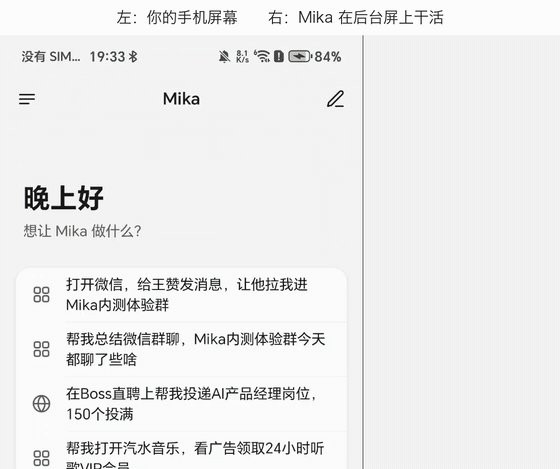
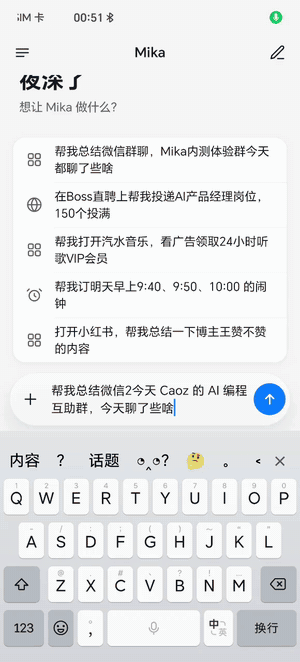
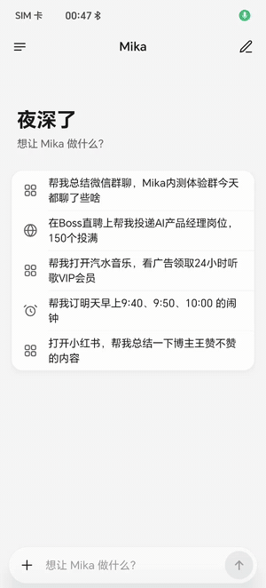
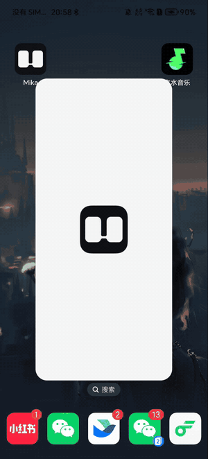
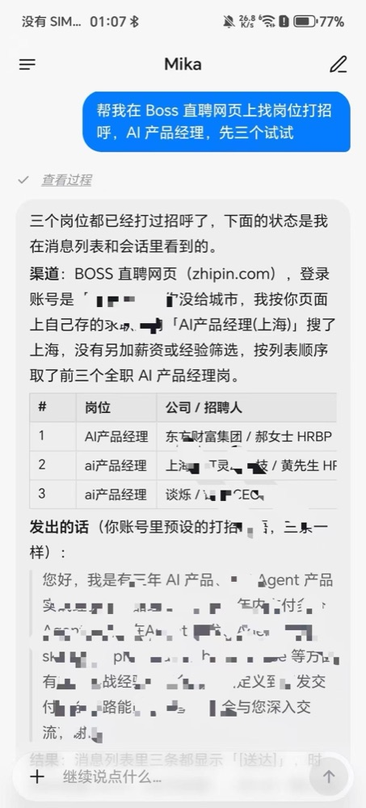
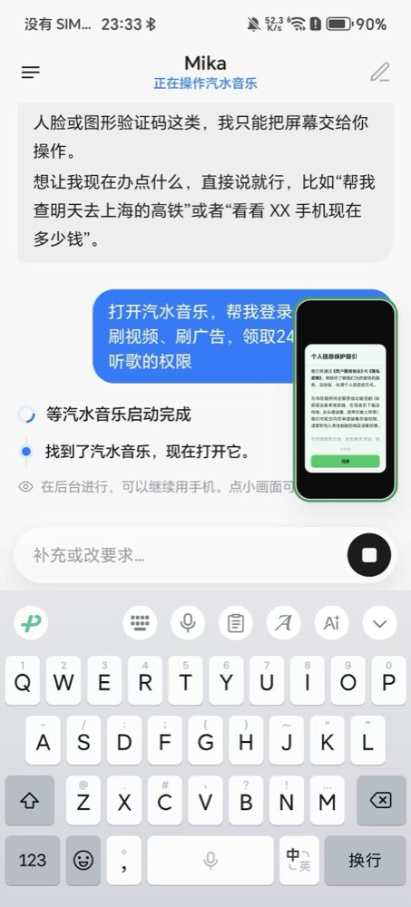
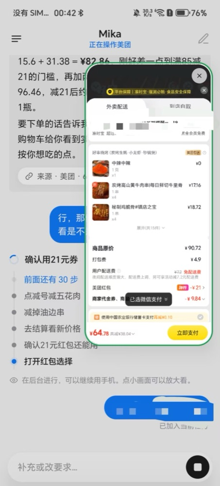

<!-- Modified for Yunkai from Mika d68159366abaea523c5e4e6fd4dc83aad78f9698; see UPSTREAM.md and UPSTREAM_CHANGES.json at repository root. -->
> **Yunkai Next isolated import prototype:** the retained documentation below describes upstream Mika, not verified Yunkai functionality. APK/release/author/feedback links belong to original Mika, not Yunkai updates. Update entry points are disabled in this prototype. See repository-root `UPSTREAM.md`.

<div align="center">


# Mika

**A personal AI assistant on your phone that operates apps, browses the web and gets things done for you.**

It works on a hidden background screen, so you can keep using your phone.

<a href="https://github.com/wangzan101/Mika/releases/latest"></a>


<a href="LICENSE"></a>

[Download APK](https://github.com/wangzan101/Mika/releases/latest) · [Quick start](#quick-start) · [What it can do](#what-it-can-do) · [FAQ](#faq) · [Contributing](#contributing)

[简体中文](README.md) | English

</div>

> **Language**
>
> - The app UI is in English and Chinese. It follows your system language (Chinese on a Chinese system, English otherwise), and you can switch in Settings › Language. Setting names below are given in English with the Chinese label in parentheses, e.g. 「设置手机操作」.
> - The built-in knowledge about apps and websites is written in Chinese. That does not limit you: the model reads it fine, and you can talk to Mika in English.
> - Many demos and built-in knowledge cover apps popular in China, but Mika is not tied to them: it can operate any app or website on your phone.

## Beta notes

- This is an early public beta. Features and UI are still changing quickly, and upgrades may include breaking changes.
- So far it has mainly been tested on one Android 14 phone. Other Android versions and other phones may hit problems we have not seen yet; [reports are welcome](#contributing).
- Mika operates third-party apps and websites on your behalf. Please read the [disclaimer](#disclaimer) first.

## Demo

<p align="center"><br/>Sending a WeChat message in the background: Mika's chat page on the left, each step on Mika's background screen on the right<br/><sub>(4× speed; the chat list is blurred)</sub></p>

<table>
<tr>
<td align="center" width="33%"><br/>Reads through a WeChat group in the background and summarizes today's chat<br/><sub>(sped up; the summary quotes group members, so its text is blurred)</sub></td>
<td align="center" width="33%"><br/>Opens Xiaohongshu and summarizes a creator's posts<br/><sub>(sped up)</sub></td>
<td align="center" width="33%"><br/>Greets recruiters for 3 jobs on the BOSS Zhipin website<br/><sub>(sped up)</sub></td>
</tr>
</table>

<table>
<tr>
<td align="center" width="33%"><br/>Finds jobs and greets recruiters on the BOSS Zhipin website</td>
<td align="center" width="33%"><br/>Opens Qishui Music and watches ads to claim listening perks</td>
<td align="center" width="33%"><br/>Orders food delivery on Meituan, stacking discounts, and asks you before paying</td>
</tr>
</table>

<sub>WeChat is China's main messaging app; Xiaohongshu (RED) is a lifestyle and social platform; BOSS Zhipin is a job-hunting site; Qishui Music is a music streaming app; Meituan is a food-delivery and local-services app.</sub>

## What it can do

Tell Mika what you want in one sentence, and it gets it done on your phone.

### Operates any app without taking over your screen

Any app installed on your phone works, with no per-app integration: Mika looks at the screen, finds buttons, taps and types like a person would. If it can see it, it can operate it.

- Opens apps on a separate background screen and reads, taps, types and scrolls there while you keep using your phone. A small live view in the chat shows what it is doing.
- Reads long lists and chat histories screen by screen, e.g. "summarize what my group chat talked about today".
- Works even with apps whose UI cannot be read directly (custom-drawn UI, unlabeled controls): Mika reads on-screen text with the text recognition bundled in the APK, and with a vision-capable model it can also find buttons and input fields from screenshots.
- Can share a piece of text straight into an app (to send a message or save a note); Mika still picks the recipient and taps send on that page itself.
- Recognizes the system asking "open with which app", a dual-installed app asking "which one", and one app opening another (e.g. jumping to a payment page). It carries on when it can, and stops to let you act on screen when you need to choose or handle it yourself.
- Things only you should do (logging in, verification codes, payment) trigger a notification asking you to take over: the app moves to your main screen, you finish and hand it back, and Mika re-checks before continuing.

### Built-in browser

- Opens any website in the background and operates the page with real clicks and keyboard input. Pages open in desktop mode by default.
- Reads the page text as well as the data the page itself receives; supports downloads and uploads.
- Logins persist. You can browse yourself from "Browser" (浏览器) in the side drawer, and sites you log into there are available to Mika too.
- Paces itself: consecutive page loads on the same site are spaced out, longer on sites that limit browsing speed. It recognizes anti-bot block pages and hands them to you instead of forcing through.

### The screen you are looking at

- While you are in another app, a floating Mika capsule at the screen edge shows background task progress, things that need you, and results. Tap it to add a message, answer, approve or stop.
- **Double-tap the capsule** to send the screen you are looking at to Mika, e.g. "how should I reply to this" or "note this down". You can also take a screenshot from the card and add a line before sending.

### Scheduled and conditional tasks

- "Remind me at 9 tomorrow morning", "check the weather every morning and tell me only if it will rain", "do X every Friday".
- Runs at the scheduled time in the original conversation and sends the result back. The scheduled tasks page lets you pause, reschedule, run now or delete.

### Interrupt or stop anytime

- Keep talking while a task runs to add to or correct your request; Mika reads it before its next step.
- When you press stop, Mika adds a short wrap-up: what it did, what it saw, how many times it sent something, and what is left. Say "continue" next time and it knows where to pick up.

### Ask / Autonomous

- The default is **Ask**: spending, irreversible actions such as deletion, and unknown-risk actions need confirmation; routine sending, editing and nonpayment form submission remain direct. You can switch to **Autonomous**, which does not ask even before paying. See [below](#ask--autonomous-mode).

### Memory

- Remembers facts, preferences and ways of doing things that you state explicitly (ways of doing things need your approval). You can view, edit and delete them. It only learns from what you yourself say, and never stores passwords, verification codes, card numbers and the like. Memory is stored encrypted on the phone.

### Faster and steadier on familiar apps and websites

Even without any instructions, Mika can get things done by looking at the screen. For some apps and websites there is extra usage knowledge (where things are, common ways to do things, what to watch out for), which Mika looks up automatically when it needs it, so it takes fewer wrong turns. For example, in a chat app it already knows how to find a contact and scroll through chat history; on a job site it knows how to filter jobs and greet recruiters. There are also general how-to skills for a few kinds of tasks. The knowledge keeps growing and anyone can add to it: it is plain text under [`core/src/main/resources/knowledge/`](core/src/main/resources/knowledge/) and [`core/src/main/resources/skills/`](core/src/main/resources/skills/). [Contributions welcome](#contributing).

Apps and websites that already have usage knowledge (names as they appear in the knowledge files; anything not listed still works):

<!-- generated:knowledge:start -->
<!-- Generated by ./gradlew updateReadme; do not edit by hand -->
| Category | Built in |
|---|---|
| **Apps** | Android 设置, 百家号, 哔哩哔哩, BOSS直聘, 得到, 抖音, 飞书, Gmail, 即刻, 快手, 领英, QQ邮箱, 今日头条, 微信, 微博, 闲鱼, 小红书, 知乎 |
| **Websites** | 哔哩哔哩, 豆瓣, 抖音, Instagram, 百度贴吧, 微博, 搜狗微信, 小红书, 小宇宙, YouTube, 知乎, BOSS直聘 |
| **How-to skills** | 把内容整理成文字, 处理 PDF 文档, 查清一件事, 消息与邮件, 云开 · 大白话讲解, 云开 · 狗头军师 |
<!-- generated:knowledge:end -->

### Batch jobs

- Batch work (e.g. greeting or applying one by one) starts right away without asking you to confirm the list first. It waits a random interval between items, and stops and tells you when the site itself says you have hit a limit.

### Everything is traceable

- Answers list their sources (pages read, screenshots), and every task has a step-by-step record you can review.
- Each task ends with a one-line summary: total time, model round trips, tokens used, and time to first feedback. "Token usage" (Token 用量) in Settings breaks usage down by day, provider and model.

### Linux sandbox

- Each conversation gets a workspace that can run Python, Node and shell commands, process files you send, and save results to your phone's Download/Mika folder.
- Offline by default; when needed, turn on "Allow scripts to access the network" (允许脚本联网) under "Files & compute" (文件与计算环境) in Settings. arm64 devices only.

## Quick start

### Requirements

| Item | Requirement |
|---|---|
| Install | Android 11 or later |
| Run tasks | Android 13 or later (required by the background screen and the built-in phone helper) |
| Recommended | Android 14 or later: the background screen has its own focus, so it does not interfere with your typing on the main screen; running tasks from different conversations at the same time also needs it |
| Linux sandbox | arm64 devices only; on other devices the app installs normally and the sandbox shows "not supported on this device" |
| Model | An API key for an LLM that supports tool calling |

### 1. Download and install

Download the latest APK from [Releases](https://github.com/wangzan101/Mika/releases/latest) and install it.

### 2. Accessibility (you can skip it for now)

Mika uses accessibility to read the UI and tap. You don't need to turn it on by hand: once pairing succeeds in the next step, Mika turns it on by itself. For apps installed from GitHub rather than an app store, Android often blocks turning accessibility on manually ("Restricted setting"), and letting Mika do it avoids that. When the wizard reaches this step, just choose Skip.

### 3. Pair wireless debugging (once)

Open "Set up phone control" (设置手机操作) in Settings and follow the checklist: enable Developer options, USB debugging and Wireless debugging, then pair using the 6-digit pairing code.

First time, stuck on a step, or not sure where the pairing code goes? See the [phone control setup guide](docs/setup-guide.en.md): it covers where to tap for each step, how to tell it worked, and fixes for common snags.

Why this step: Mika has a built-in phone helper that launches and operates apps on the background screen, and it uses Android's own wireless debugging to start that helper. Everything happens on the phone; no computer or cable needed. After pairing, if the system turns wireless debugging off (Android does this when you change Wi-Fi or reboot), Mika turns it back on by itself, with your permission.

If you only want web browsing, files and chat, you can skip this step for now.

### 4. Add a model

Open "Models" (模型) in Settings (the app also walks you through this on first launch).

<!-- generated:providers:start -->
<!-- Generated by ./gradlew updateReadme; do not edit by hand -->
Presets for DeepSeek, 通义千问, Kimi, 智谱, 硅基流动, 火山方舟, MiniMax, 阶跃星辰, 腾讯混元, 百度千帆, OpenRouter, OpenCode Go, Anthropic, Gemini, OpenAI, xAI, Mistral, Groq, Ollama, LM Studio and more; for any other provider pick Custom (自定义), which takes any OpenAI-compatible, Anthropic or Gemini endpoint.
<!-- generated:providers:end -->

You can also skip the API key and sign in with ChatGPT (Plus or Pro, uses your plan's usage): tap "Continue with ChatGPT" when adding a provider, sign in in the browser, then come back to Mika.

1. Add a provider: pick a preset, or pick Custom and enter the endpoint URL; enter your API key. For servers you run yourself, such as Ollama or LM Studio, the address is prefilled with the default port; change it to that machine’s address, and the key is optional.
2. Tap "Test and save" (测试并保存). When you connect your first provider, a main model is picked automatically.
3. The main model must support tool calling. Optional: a vision model (understands the UI and finds buttons in screenshots) and a light model (anything cheap and fast; handles small jobs like judging task outcomes and extracting memories).

### 5. Try it

An empty conversation shows a few examples you can tap, edit and send. Or try something like:

- "Summarize what my WeChat group talked about today"
- "Open Xiaohongshu and summarize what this creator posted recently"
- "Set alarms for 9:40, 9:50 and 10:00 tomorrow morning"
- "Check the weather at 8 every morning and tell me only if it will rain"

## Ask / Autonomous mode

One global switch: "Developer options" (开发者选项) → "Autonomous mode" (自主模式) in Settings. Off means Ask, on means Autonomous.

| Mode | Behavior |
|---|---|
| **Ask** (default) | Spending, irreversible actions (including deletion) and identified unknown-risk actions require one-time approval. The card names the affected target and change; amount is required for orders/spending and omitted for nonpayment actions. Payment itself is handed to you. Routine sends, edits and nonpayment forms remain direct. Targets without bound screen evidence require re-observation, not blind approval. Nonpayment deletion approvals bind to the actual target, not unrelated text elsewhere on screen. |
| **Autonomous** | Does not ask even before paying. The spacing between items in batch jobs still applies. |

- The switch applies to all tasks from then on; if a running task switches from Ask to Autonomous, payments are no longer asked about from the next step.
- In both modes Mika asks you to take over for things only you should do, like logging in, verification codes and payment passwords. It also asks when information is missing or only you can decide (e.g. which of two contacts with the same name).
- For tasks that run while you are away, such as scheduled tasks, Ask mode refuses spending, irreversible and unknown-risk steps rather than waiting for approval. Non-UI runs have the same restriction. Routine actions retain their existing behavior.

## Data and privacy

- **There is no Mika server.** What you say, screen contents and screenshots go only to the model provider you configure.
- API keys, memories and your user profile are encrypted with the Android Keystore and stored on the phone. Conversations, run records and token usage stay on the device.
- Update checks only contact GitHub.
- The built-in browser visits only the sites you send it to; the sandbox is offline by default.

## Disclaimer

- Operating third-party apps and websites through automation may violate their terms of service and carries a risk of restricted features or account bans. Use your own judgment, at your own risk.
- You are responsible for actions you approve (and for actions Mika takes on your behalf in Autonomous mode). For anything important, use Ask mode and check the results.
- This is beta software, provided "as is", without warranty of any kind (see [LICENSE](LICENSE)).

## FAQ

**Wireless debugging turned itself off?**
Stock Android turns off wireless debugging when Wi-Fi disconnects or the phone reboots. "Auto-enable wireless debugging" (自动打开无线调试) under "Recovery & repair" (恢复与修复) in Settings is on by default: when needed, Mika turns it on and reconnects (this requires allowing Mika to modify system settings). The first time on a given Wi-Fi network, the system asks for permission; turn it on manually once and check "Always allow on this network". If it still cannot connect, go back to the "Set up phone control" (设置手机操作) wizard in Settings and pair again.

**The accessibility service got turned off?**
The system sometimes stops accessibility services (e.g. after the process is cleaned up). "Turn on accessibility for me" (替我打开无障碍) is on by default, so Mika turns it back on itself; if that fails, the Settings page prompts you to turn it on manually.

**Some app screens cannot be read or captured?**
Some screens (e.g. payment or password entry) block screenshots, so Mika cannot see them and will not try to read text on them. You need to take over on those screens and hand back to Mika when done.

**Why Android 13?**
Mika operates apps on a separate background screen, and the built-in phone helper and that screen need Android 13 or later. From Android 14 the background screen has its own focus and does not interfere with your typing on the main screen, so it is recommended. Web, sandbox and chat also work on Android 11 and 12.

**Can I use a model running on my own computer or LAN?**
Yes. When adding a provider choose "Custom" (自定义); the base URL may start with `http://`, e.g. `http://192.168.1.10:11434/v1` (with the phone on the same Wi-Fi). Local and LAN addresses show no warning; an unencrypted address outside your LAN shows a short warning, since your API key and chats could be seen by others on the network. Use `https://` when you can.

**Where do APK updates come from?**
Only from this repository's [GitHub Releases](https://github.com/wangzan101/Mika/releases). Each release's notes list what changed.

## Contributing

### Add app / website knowledge (no code needed)

The easiest contribution: write an `APP.md` for an app or a `SITE.md` for a website, or improve an existing one. They are plain-text Markdown files with a header, under `core/src/main/resources/knowledge/`. See [`docs/knowledge-format.md`](docs/knowledge-format.md) for the format. Existing knowledge is in Chinese, but new files can be written in English.

### Report issues

When opening an issue, please include your **phone model, Android version and Mika version** ("About Mika" (关于 Mika) in Settings), what you did, what you expected and what actually happened. Screenshots from "View steps" (查看过程) help a lot (hide anything private first).

### Contribute code

PRs welcome. Start with [`docs/architecture.md`](docs/architecture.md) (written against the current code, with class names and file paths) and [`docs/roadmap.md`](docs/roadmap.md) (done, next, known issues). Please include unit tests with your changes. The docs are in Chinese for now.

## For developers

### Build and test

Requires JDK 17 and the Android SDK (`sdk.dir` in `local.properties`, or the `ANDROID_HOME` environment variable).

```bash
./gradlew :app:assembleDebug                  # debug build
./gradlew :app:assemblePerf                   # build for judging smoothness: precompiled and non-debuggable like release, debug-signed, installs over the debug build
./gradlew :core:test :app:testDebugUnitTest   # unit tests
```

The debug build is not precompiled and its UI is several times slower; use the perf build to judge smoothness.

- The repository has two modules: `:core` is pure Kotlin and holds the main loop, tools, prompts and knowledge, and can be run on a computer with unit tests and a fake model; `:app` is the Android host.
- The sandbox's native binaries and bundled runtime are checked into the repository; to rebuild them see [`tools/sandbox/README.md`](tools/sandbox/README.md).
- For on-device evaluation see [`eval/README.md`](eval/README.md).

### Model configuration details

- Three roles: the **main model** (does the work; must support tool calling), the **vision model** (describes the UI and locates things in screenshots; off by default on a fresh install, or choose "use main model"), and the **light model** (small jobs like judging outcomes, extracting memories and understanding intent; defaults to the main model).
- "Test and save" calls the provider’s public list-models endpoint once, then gives the model that would become your main model a test tool and asks it to call it (a few dozen tokens). Only if both work is the provider saved; otherwise you see why right away, including the server’s own error message. Which model is tried first: the provider’s own models (for Qwen, ones with “qwen” in the name), then ones the list says can call tools; embedding, rerank, speech and image models are skipped. If the tried model fails for a reason of its own (your account hasn’t activated it or has no access, there is no such model, or it doesn’t call tools), the next one is tried, up to 3: the one that passes becomes your main model and you’re told which ones didn’t; if none passes, the provider is still saved (the key works) without a main model, and you’re asked to pick an activated one from the list, which is tested before it’s used. Key, network and address problems still stop the save. If no models are listed (the provider may not offer a list, or the address or interface type may be wrong), you enter a model name and the test call uses it; it’s saved only if that works, and a missing model is reported by name with an example of what model names look like. If a custom address is a known provider’s official one, you’re offered that provider’s preset (one tap, your key is kept). For providers without a list, a model name typed when picking a role is tested the same way first; ones that were never tested show “Not tested” on the provider row, with “Test again” on its page.
- Capability tags on the model list (tool calling, vision, context length) show what the API reports; anything it does not report falls back to the preset's initial values and is marked "unconfirmed". They are for reference only and never block anything.
- "Vision grounding verified" lives in "Developer options" in Settings (visible in debug builds) and applies to the current vision model.

### Docs

- [`docs/architecture.md`](docs/architecture.md): overall structure.
- [`docs/roadmap.md`](docs/roadmap.md): done, next, known issues and deferred items.
- [`docs/knowledge-format.md`](docs/knowledge-format.md): format of app and website knowledge and skills.
- [`docs/sandbox/skill-scripts.md`](docs/sandbox/skill-scripts.md): sandbox scripts that come with knowledge and skills.

### Releases and updates (maintainers)

- Releases are published on GitHub Releases with tags `vX.Y.Z`, with the APK attached to the release.
- Update checks: each time you open the app it queries `https://api.github.com/repos/wangzan101/Mika/releases/latest` and no other address.

## Star history

<a href="https://star-history.com/#wangzan101/Mika&Date">
  <picture>
    <source media="(prefers-color-scheme: dark)" srcset="https://api.star-history.com/svg?repos=wangzan101/Mika&type=Date&theme=dark" />
    
  </picture>
</a>

## Contact

- X: [@wangzan101](https://x.com/wangzan101)
- WeChat: in the app, open "About Mika" (关于 Mika) in Settings and scan the code to add the author on WeChat, with the note "Mika", to join the beta group.

## License

Mika is released under the [Apache License 2.0](LICENSE); see [NOTICE](NOTICE) for the copyright notice.

Third-party components keep their own licenses; see [THIRD_PARTY_NOTICES.md](THIRD_PARTY_NOTICES.md). In particular, the APK contains standalone executables `libproot.so` and `libproot_loader.so` built from PRoot (GPL-2.0-or-later, statically linked with talloc, LGPL-3.0-or-later); Mika only runs them as child processes. Source locations and checksums are in [`tools/sandbox/sources.lock`](tools/sandbox/sources.lock), patches are in `tools/sandbox/patches/`, and they can be rebuilt with `tools/sandbox/build-native.sh`. The sandbox runtime (a minimal Alpine Linux 3.22 root filesystem and packages) ships with the APK, and the matching source packages are attached to each release; see [`tools/sandbox/README.md`](tools/sandbox/README.md) for how.
