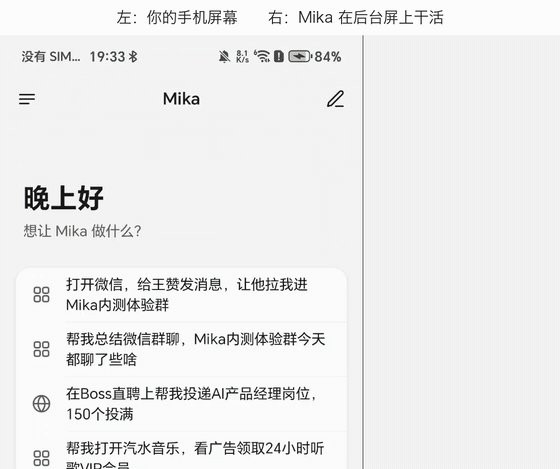
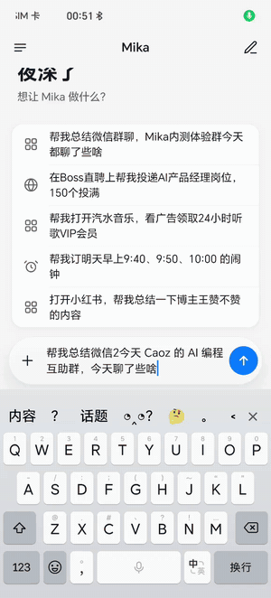
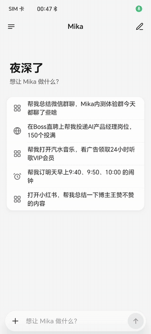
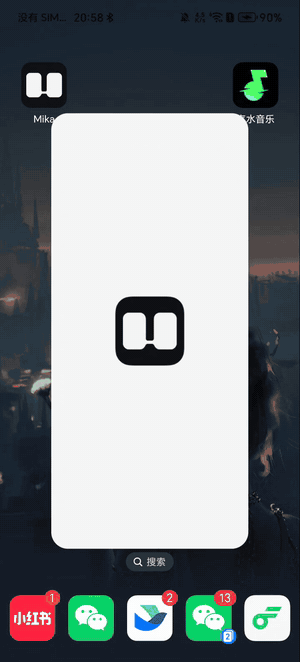
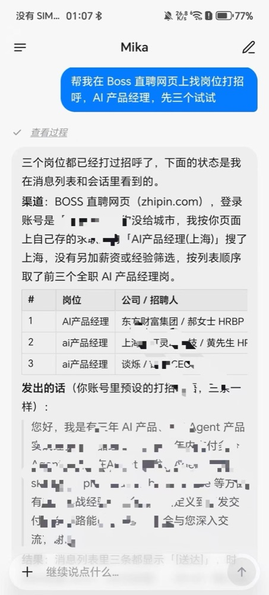
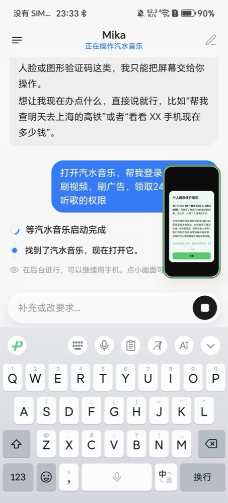
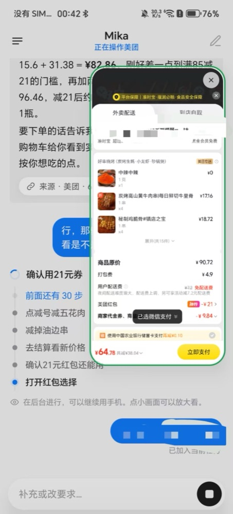

<!-- Modified for Yunkai from Mika d68159366abaea523c5e4e6fd4dc83aad78f9698; see UPSTREAM.md and UPSTREAM_CHANGES.json at repository root. -->
> **云开 Next 独立导入原型**：以下为保留的 Mika 上游说明，不是云开功能验证或发布承诺。文中的 APK 下载、发布、作者和反馈链接均属于原始 Mika；不要将上游 APK 当成云开更新。当前原型更新入口停用；详情见仓库根目录 `UPSTREAM.md`。

<div align="center">


# Mika

**你手机上的私人 AI 助理，替你操作 App、上网、把事办成。**

它在一块看不见的后台屏上干活，你照样刷你的手机。

An on-device AI agent for Android that operates apps and the web to get things done for you — on a hidden background screen, so you can keep using your phone.

<a href="https://github.com/wangzan101/Mika/releases/latest"></a>


<a href="LICENSE"></a>

[下载 APK](https://github.com/wangzan101/Mika/releases/latest) · [快速开始](#快速开始) · [能做什么](#能做什么) · [常见问题](#常见问题) · [参与贡献](#参与贡献)

简体中文 | [English](README.en.md)

</div>

> **English summary**
>
> Mika is an Android app that takes a one-sentence request and carries it out on your phone. It drives apps on a private background screen (so you can keep using your phone), browses the web in a built-in desktop-class browser, and runs scripts in a local Linux sandbox. You bring your own model API key (several providers are supported as presets, plus any OpenAI-compatible, Anthropic or Gemini endpoint). There is no Mika server: your requests go only to the model provider you configure.
>
> Status: **public beta**, changing quickly (see [Releases](https://github.com/wangzan101/Mika/releases) for versions and changes). Install on Android 11+, tasks need Android 13+, Android 14+ recommended. The sandbox runs on arm64 devices only. The app UI is available in English and Chinese (follows your system language; switch in Settings › Language); see the [full English README](README.en.md). Licensed under Apache-2.0.

## Beta 说明

- 这是早期公开测试版，功能和界面还在快速变化，升级时可能有不兼容的改动。
- 目前主要在一台安卓 14 手机上测试过。别的安卓版本、别的手机上可能遇到没见过的问题，欢迎[反馈](#参与贡献)。
- Mika 会替你操作第三方 App 和网站，请先读[免责声明](#免责声明)。

## 演示

<p align="center"><br/>后台发微信：左边是 Mika 的对话页，右边是 Mika 在后台屏上的每一步<br/><sub>（加速 4 倍；聊天列表已打码）</sub></p>

<table>
<tr>
<td align="center" width="33%"><br/>后台翻完微信群，总结今天聊了啥<br/><sub>（加速播放；总结正文涉及群友发言，已打码）</sub></td>
<td align="center" width="33%"><br/>打开小红书，总结一位博主的内容<br/><sub>（加速播放）</sub></td>
<td align="center" width="33%"><br/>在 BOSS 直聘网页上给 3 个岗位打招呼<br/><sub>（加速播放）</sub></td>
</tr>
</table>

<table>
<tr>
<td align="center" width="33%"><br/>在 BOSS 直聘网页上找岗位、打招呼</td>
<td align="center" width="33%"><br/>打开汽水音乐，看广告领听歌权益</td>
<td align="center" width="33%"><br/>在美团上凑满减、点外卖，付款前问你</td>
</tr>
</table>

## 能做什么

你用一句话交代一件事，Mika 在手机上替你办。

### 操作任何 App，不占你的屏幕

手机上装的 App 都能操作，不用事先适配：Mika 像人一样看屏幕、找按钮、点击输入，看得到就能操作。

- 在一块单独的后台屏上打开 App、读界面、点击、输入、滚动，你照常用手机；对话页上的小画面实时显示它在做什么。
- 能逐屏读长列表和聊天记录，比如「帮我总结一下某个群今天都聊了些啥」。
- 界面读不出来的 App（自己画界面、控件没有名字）也能用：Mika 用随 APK 自带的文字识别读屏上的字；配了能看图的模型时，还能看图找按钮和输入框。
- 能把一段文字直接分享进某个 App（发消息、记笔记），收件人和发送仍由 Mika 在那一页上点。
- 系统问「用哪个 App 打开」、装了两份的 App 问「打开哪一个」、一个 App 打开另一个 App（比如跳到付款页）时，Mika 认得出来：能处理的接着做，要你选或要你亲手处理的，会停下来请你在屏幕上操作。
- 需要你亲手处理的事（登录、验证码、付款）会发通知请你接管：App 挪到主屏，你处理完交还，Mika 重新核实再继续。

### 内置浏览器

- 任何网站都能打开：在后台打开网页，用真实的点击和键盘输入操作页面，默认按电脑版网页打开。
- 能读页面正文，也能读页面自己收到的数据；支持下载、上传。
- 登录过的网站保持登录；侧栏「浏览器」里可以自己浏览，在这里登录的网站 Mika 办事时也能直接用。
- 翻页有节奏：同一个网站连着换页会停一停，对限制浏览快慢的网站停得更久；认得出风控拦截页，交给你处理而不是硬闯。

### 此刻的屏幕

- 你在别的 App 里时，屏幕边上有一颗 Mika 悬浮胶囊，显示后台任务的进展、要你处理的事和结果，点开可以插话、回答、同意或停止。
- **双击胶囊**，把你正在看的这一屏发给 Mika，比如「这个怎么回」「帮我记下来」；也可以在卡片里截屏、补一句话再发。

### 定时与条件任务

- 「明早 9 点提醒我」「每天早上看看天气，下雨才告诉我」「每周五做某件事」。
- 到点在原对话里执行，结果送回来；定时任务页可以暂停、改时间、立即执行、删除。

### 随时插话、随时停

- 任务进行中可以继续说话，补充或更正要求，Mika 在下一步之前读到。
- 按停止后，Mika 会补几行交代：做了什么、看到了什么、发出了几次、哪些没做完。下次说「继续」它知道从哪接着做。

### 询问 / 自主

- 默认是**询问**：花钱、删除等不可逆和未知风险操作先问你；一般发送、编辑和不花钱的表单提交照常直接做。也可以换成**自主**，连付款也不先问。详见[下文](#询问--自主模式)。

### 记忆

- 记住你明确说过的事实、偏好和做事方式（做事方式要你批准），可以查看、修改、删除；只从你自己说的话里记，密码、验证码、卡号这类不记。记忆加密保存在手机上。

### 熟悉的 App 和网站，做得更快更稳

没有任何说明，Mika 也能看着屏幕把事办成。有些 App 和网站另外写了使用知识（入口在哪、常见做法、要注意什么），Mika 用到时自动查阅，少走弯路。比如进了聊天 App 直接知道怎么找联系人、翻聊天记录；打开招聘网站知道怎么筛岗位、打招呼。另有几类事情的通用做法。知识持续增加，人人可以补充：它们是放在 [`core/src/main/resources/knowledge/`](core/src/main/resources/knowledge/) 和 [`core/src/main/resources/skills/`](core/src/main/resources/skills/) 下的纯文本文件，[欢迎补充](#参与贡献)。

已经写了使用知识的（没写到的 App 和网站照样能用）：

<!-- generated:knowledge:start -->
<!-- 这一段由 ./gradlew updateReadme 生成，不要手改 -->
| 类别 | 内置 |
|---|---|
| **App** | Android 设置、百家号、哔哩哔哩、BOSS直聘、得到、抖音、飞书、Gmail、即刻、快手、领英、QQ邮箱、今日头条、微信、微博、闲鱼、小红书、知乎 |
| **网站** | 哔哩哔哩、豆瓣、抖音、Instagram、百度贴吧、微博、搜狗微信、小红书、小宇宙、YouTube、知乎、BOSS直聘 |
| **通用做法**（技能） | 把内容整理成文字、处理 PDF 文档、查清一件事、消息与邮件、云开 · 大白话讲解、云开 · 狗头军师 |
<!-- generated:knowledge:end -->

### 成批的事

- 成批做事（比如逐个打招呼、投递）直接开始，不用先跟你确认名单；每两次之间隔开一段随机时间，做到网站自己说「到上限了」就停下告诉你。

### 过程可查

- 回答下面列出来源（读过的页面、截图）；每次任务都有可回看的过程记录。
- 每次任务一行小结：总用时、和模型来回几次、用了多少 Token、多久看到第一次反馈；设置里的「Token 用量」按天、按服务商、按模型统计。

### Linux 沙箱

- 每个对话一个工作区，可以跑 Python、Node 和 shell 命令，处理你发来的文件，把结果存到手机的「下载/Mika」。
- 默认断网，需要时在设置里的「文件与计算环境」打开「允许脚本联网」。只支持 arm64 设备。

## 快速开始

### 系统要求

| 项目 | 要求 |
|---|---|
| 安装 | 安卓 11 及以上 |
| 执行任务 | 安卓 13 及以上（后台屏和内置手机助手的要求） |
| 推荐 | 安卓 14 及以上：后台屏有自己的焦点，不影响你在主屏打字；不同对话的任务同时进行也需要它 |
| Linux 沙箱 | 仅 arm64 设备；其他设备照常安装，沙箱显示「此设备不支持」 |
| 模型 | 一个支持工具调用的大模型 API Key |

### 1. 下载安装

从 [Releases](https://github.com/wangzan101/Mika/releases/latest) 下载最新的 APK 安装。

### 2. 无障碍（可以先跳过）

Mika 靠无障碍读界面、做点按。不用手动去开：下一步配对成功后，Mika 会自己把它打开。从 GitHub 下载安装的 App，手动打开无障碍时常被系统拦下（提示「受限制的设置」），让 Mika 自己开能省掉这个麻烦。向导里到这一步时选「跳过」即可。

### 3. 配对无线调试（只需一次）

打开设置里的「设置手机操作」向导，照着清单做：打开开发者选项、USB 调试、无线调试，然后用 6 位配对码配对。

第一次设置、卡在某一步，或者不知道配对码填在哪里：看[手机操作设置指南](docs/setup-guide.md)，每一步都写了在哪里点、怎么算成功、常见问题怎么办。

为什么要这一步：Mika 有一个内置的手机助手，要在后台屏上启动和操作 App，需要借用安卓自带的无线调试来启动它。全程在手机上完成，不需要电脑和数据线。配对过后，如果无线调试被系统关掉了（换 Wi-Fi、重启手机后安卓会关掉它），Mika 在你允许的前提下会自己把它重新打开。

只用上网、文件和聊天的话，这一步可以先跳过。

### 4. 添加模型

打开设置里的「模型」（第一次打开 App 时也会引导你）。

<!-- generated:providers:start -->
<!-- 这一段由 ./gradlew updateReadme 生成，不要手改 -->
内置 DeepSeek、通义千问、Kimi、智谱、硅基流动、火山方舟、MiniMax、阶跃星辰、腾讯混元、百度千帆、OpenRouter、OpenCode Go、Anthropic、Gemini、OpenAI、xAI、Mistral、Groq、Ollama、LM Studio 等服务商预设；其他服务商选「自定义」，OpenAI 兼容、Anthropic、Gemini 接口都能接。
<!-- generated:providers:end -->

也可以不填 Key，直接用 ChatGPT 登录（Plus 或 Pro，用你的套餐额度）：在添加服务商那里点「使用 ChatGPT 继续」，在浏览器里登录后回到 Mika。

1. 添加服务商：选一个预设，或选「自定义」填接口地址；填 API Key。Ollama、LM Studio 这类自己机器上跑的服务，地址预填了默认端口，改成那台机器的地址即可，Key 可不填。
2. 点「测试并保存」，连上第一家时会自动选一个主模型。
3. 主模型要支持工具调用。可选：看图模型（看懂界面、看图找按钮）、轻量模型（便宜快的即可，处理判断结局、提取记忆等小事）。

### 5. 试一试

空对话里有几条示例，点一下就能改了再发。也可以这样说：

- 「帮我总结一下微信群今天都聊了些啥」
- 「打开小红书，帮我总结一下某个博主最近发的内容」
- 「帮我订明天早上 9:40、9:50、10:00 的闹钟」
- 「每天早上 8 点看看天气，下雨才告诉我」

## 询问 / 自主模式

全局一个开关：设置里的「开发者选项」→「自主模式」，关着是询问，打开是自主。

| 模式 | 行为 |
|---|---|
| **询问**（默认） | 花钱、删除等不可逆和有明确对象的未知风险操作要你同意这一次。卡片说明影响的对象和改动；下单或花钱必须填屏上金额，非花钱操作不填金额。付款本身由你亲手完成。一般发送、编辑和不花钱的表单提交直接做；无法绑定目标时先重新观察，不能盲目申请同意；非花钱删除审批要核对实际作用对象，屏上别处有同名文字不算。 |
| **自主** | 连付款也不先问你，直接做完。成批做事时两次之间的间隔照样保留。 |

- 换了开关管之后的所有任务；正在做的任务从询问换成自主，下一步起付款也不再问。
- 登录、验证码、付款密码这类要你亲手处理的事，两种模式都会请你接管；信息不够、或者只有你能选（比如两个同名联系人选哪个）时，也会问你。
- 定时任务等你不在场的任务，在询问模式下遇到花钱、不可逆或未知风险操作会拒绝执行，而不是等待同意；非界面发起的任务也如此，一般操作照旧。

## 数据与隐私

- **没有 Mika 的服务器。** 你的话、屏幕内容、截图只发给你自己配置的模型服务商。
- API Key、记忆和用户画像用安卓密钥库加密，保存在手机上。对话、运行记录、Token 用量都只存在本机。
- 检查更新只访问 GitHub。
- 内置浏览器访问的是你让它去的网站；沙箱默认断网。

## 免责声明

- 用自动化方式操作第三方 App 和网站，可能违反它们的用户协议，有被限制功能、封号的风险。请自行判断、自担风险。
- 你同意的动作（以及自主模式下 Mika 替你做的动作）由你负责。重要的事请用询问模式，并检查结果。
- 这是 Beta 软件，按「原样」提供，不做任何担保（详见 [LICENSE](LICENSE)）。

## 常见问题

**无线调试自己关掉了？**
安卓原版在 Wi-Fi 断开、手机重启后会关掉无线调试。设置里的「恢复与修复」中「自动打开无线调试」默认开着：需要时 Mika 会自己打开它再连接（要你允许 Mika 修改系统设置）。第一次在某个 Wi-Fi 上，系统会问是否允许，请手动打开一次并勾选「始终允许使用此网络」。如果还是连不上，回到设置里的「设置手机操作」向导重新配对即可。

**无障碍服务被关掉了？**
系统有时会停掉无障碍服务（比如进程被清理后）。「替我打开无障碍」默认开着，Mika 会自己把它重新打开；修不好时设置页会提示你手动打开。

**有的 App 页面读不到、截不到？**
有些页面（比如付款、输密码）禁止截屏，Mika 看不到画面，也不会去识别上面的字。这类页面需要你接管处理，处理好交还给 Mika。

**为什么要安卓 13？**
Mika 在一块单独的后台屏上操作 App，内置手机助手和这块屏需要安卓 13 及以上。安卓 14 起后台屏有自己的焦点，不会影响你在主屏打字，所以更推荐。只用网页、沙箱和聊天，安卓 11、12 也能用。

**能用自己电脑或局域网里跑的模型吗？**
可以。添加服务商时选「自定义」，接口地址填 `http://` 开头的也行，比如 `http://192.168.1.10:11434/v1`（手机和那台电脑在同一个 Wi-Fi 下）。本机和局域网的地址不加提示；不加密又不在局域网里的地址会提醒一句：API Key 和对话内容可能被同一网络里的人看到，能用 `https://` 就用。

**APK 更新从哪来？**
只从本仓库的 [GitHub Releases](https://github.com/wangzan101/Mika/releases) 发布。每个版本改了什么，都写在那个版本的发布说明里。

## 参与贡献

### 补充 App / 网站知识（不用写代码）

最简单的贡献：给某个 App 写一份 `APP.md`、给某个网站写一份 `SITE.md`，或者改进已有的。它们是带头部的 Markdown 纯文本，放在 `core/src/main/resources/knowledge/` 下。格式见 [`docs/knowledge-format.md`](docs/knowledge-format.md)。

### 报告问题

开 Issue 时请写上：**手机型号、安卓版本、Mika 版本**（设置里的「关于 Mika」），做了什么、期望什么、实际发生了什么。能附上「查看过程」里的截图更好（注意先遮掉隐私）。

### 贡献代码

欢迎 PR。先读 [`docs/architecture.md`](docs/architecture.md)（按代码现状写，带类名和文件路径）和 [`docs/roadmap.md`](docs/roadmap.md)（已完成、接下来、已知问题）。改动请带单元测试。

## 开发者

### 构建与测试

需要 JDK 17 和 Android SDK（`local.properties` 里的 `sdk.dir`，或环境变量 `ANDROID_HOME`）。

```bash
./gradlew :app:assembleDebug                  # 调试包
./gradlew :app:assemblePerf                   # 看流畅度用的包：和发布版一样预先编译、不可调试，用调试签名，可直接覆盖调试包
./gradlew :core:test :app:testDebugUnitTest   # 单元测试
```

调试包不做预先编译，界面会慢好几倍；判断流畅度请用 perf 包。

- 仓库有两个模块：`:core` 是纯 Kotlin，主循环、工具、提示词、知识都在这里，可以在电脑上用单测和假模型跑；`:app` 是安卓宿主。
- 沙箱的原生程序和自带运行环境已在仓库里；重新构建见 [`tools/sandbox/README.md`](tools/sandbox/README.md)。
- 真机评测见 [`eval/README.md`](eval/README.md)。

### 模型配置细节

- 三个用途：**主模型**（办事，要支持工具调用）、**看图模型**（描述界面、看图定位；新装默认不用，可选「用主模型」）、**轻量模型**（判断结局、提取记忆、理解意图等小事，默认用主模型）。
- 「测试并保存」先调一次服务商公开的列模型接口，再带一个试用的工具，请会当主模型的那个模型调用它（用掉几十个 token）；都成了才保存，哪一步不成当场说原因（服务端的报错原样显示）。先试哪个：这家自己的模型在前（例如通义千问先试名字里有 qwen 的），再是列表明说能调用工具的，向量、重排、语音、画图这类不试。试的模型是它自己的问题（这个账号没开通或没权限、没有这个模型、不会调用工具）时接着试下一个，至多 3 个：通过的当主模型，并说一句先试的哪个没通过；都没通过也保存服务商（Key 是对的），不定主模型，说明原因、请你从列表里选一个开通了的，选的时候先试调用。Key、网络、地址不对照旧不保存。没列出模型时（可能这家不提供列表，也可能地址或接口类型填错了），先填一个模型名，再测试就用它试调用，通了才保存；找不到这个模型时说清是哪个、模型名大概长什么样。自定义填的是某家的官方地址时，提醒改用那家的预设（一点就换，Key 留着）。不提供列表的服务商，在选用途时手填的模型名同样先试调用；以前没试过的，服务商那一行提醒「没测试通过」，点进去可以「重新测试」。
- 模型列表上的能力标签（工具调用、看图、上下文长度）：接口给了的照实显示，没给的沿用预设初值并标「未确认」，只作参考，不拦。
- 「看图定位已验证」在设置里的「开发者选项」（调试版可见），对当前看图模型生效。

### 文档

- [`docs/architecture.md`](docs/architecture.md)：整体结构。
- [`docs/roadmap.md`](docs/roadmap.md)：已完成、接下来、已知问题与暂缓。
- [`docs/knowledge-format.md`](docs/knowledge-format.md)：App、网站知识与技能的格式。
- [`docs/sandbox/skill-scripts.md`](docs/sandbox/skill-scripts.md)：知识与技能自带的沙箱脚本。

### 发布与更新（维护者）

- 发布在 GitHub Releases，tag 用 `vX.Y.Z`，APK 作为附件挂在这个版本上。
- 检查更新：每次打开 App 查一次 `https://api.github.com/repos/wangzan101/Mika/releases/latest`，不经别的地址。

## Star 增长

<a href="https://star-history.com/#wangzan101/Mika&Date">
  <picture>
    <source media="(prefers-color-scheme: dark)" srcset="https://api.star-history.com/svg?repos=wangzan101/Mika&type=Date&theme=dark" />
    
  </picture>
</a>

## 联系作者

- X：[@wangzan101](https://x.com/wangzan101)
- 微信：在 App 设置里的「关于 Mika」扫码加作者微信，备注「Mika」，拉你进内测群。

## 许可证

Mika 以 [Apache License 2.0](LICENSE) 发布，版权声明见 [NOTICE](NOTICE)。

第三方组件保留各自的许可证，见 [THIRD_PARTY_NOTICES.md](THIRD_PARTY_NOTICES.md)。其中：APK 里带有 PRoot（GPL-2.0-or-later，静态链接 talloc，LGPL-3.0-or-later）编译成的独立可执行程序 `libproot.so`、`libproot_loader.so`，Mika 只以子进程方式运行它们；源码地址与校验值在 [`tools/sandbox/sources.lock`](tools/sandbox/sources.lock)，补丁在 `tools/sandbox/patches/`，可以用 `tools/sandbox/build-native.sh` 重新编译。沙箱的运行环境（Alpine Linux 3.22 的最小根文件系统和软件包）随 APK 发布，发布时附带对应源码包，做法见 [`tools/sandbox/README.md`](tools/sandbox/README.md)。
